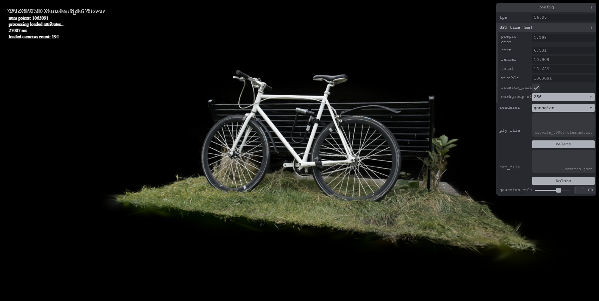
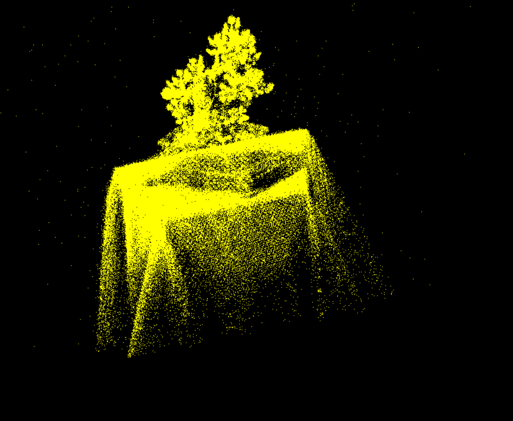
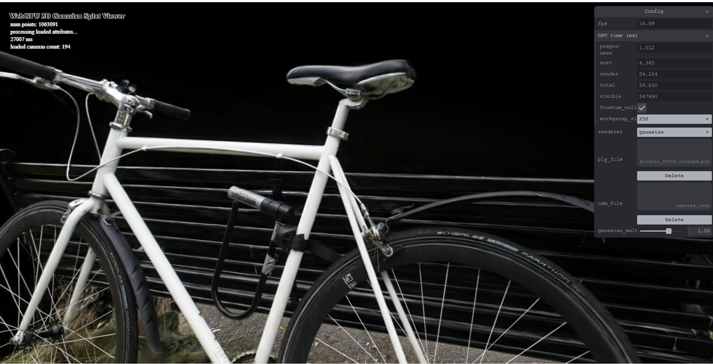

# Project5-WebGPU-Gaussian-Splat-Viewer

**University of Pennsylvania, CIS 565: GPU Programming and Architecture, Project 5**

* Yunzhe Deng
* Tested on: **Google Chrome 156.0** on Windows 11 (25H2), i7-10750H @ 2.60GHz 16GB, RTX 2060 6GB (Razer Blade 15, personal laptop)

### Live Demo

### Demo Video/GIF

### Overview

This is a 3D Gaussian Splatting viewer in WebGPU. You load a trained `.ply` scene plus its `cameras.json`, and it renders the gaussians in real time. There are three renderers you can switch between in the panel: `pointcloud`, `gaussian` and `gaussian_tile`.

Since FPS is stuck at the monitor refresh rate, I used `timestamp-query` to time the GPU directly. The panel shows preprocess / sort / render / total in ms, plus how many splats are visible. There's also a checkbox to turn culling on and off, and a dropdown to change the preprocess workgroup size.

| pointcloud                   | gaussian                   | gaussian_tile                   |
| ---------------------------- | -------------------------- | ------------------------------- |
|  |  |  |

### Part 1: Point cloud

Added the MVP transform in the point cloud vertex shader (`proj * view * pos`). The PLY positions are already in world space so there's no model matrix.

### Part 2: Gaussian renderer

Most of the work is in the preprocess compute shader, which runs one thread per gaussian. It first throws away gaussians that can't be seen: ones behind the camera, ones whose center is outside a slightly bigger box than the screen, and ones whose quad ends up completely off screen. For the rest, it builds the 3D covariance from the rotation and scale (scaled by the `gaussian_multiplier` slider), projects it to 2D with the Jacobian the same way the 3DGS CUDA code does, and inverts it to get the conic. The quad size comes from 3 sigma of the bigger eigenvalue. Color comes from the spherical harmonics and opacity goes through a sigmoid.

Every gaussian that survives grabs a slot with `atomicAdd`, writes its splat data there, and writes a depth key for the radix sort. I flip the depth bits so that the farthest splat ends up first after the ascending sort, which gives me back to front order for blending. The number of visible splats then gets copied straight into an indirect draw buffer, so the CPU never has to read it back.

The vertex shader turns each sorted splat into a quad, and the fragment shader uses the conic to work out how far the pixel is from the center and fades the opacity out with `exp`. Anything below 1/255 alpha gets discarded, and the rest is alpha blended.

### Part 3: Tile-based sorting

For this I tried to follow how the original 3DGS CUDA rasterizer works. The screen gets split into 16x16 tiles, and in preprocess each splat writes one key for every tile it touches. The key is the tile id in the top 16 bits and a 16-bit log depth in the bottom 16 bits, so it still fits in the 32-bit radix sort we were given. After sorting, all the keys for one tile sit next to each other, ordered from near to far. A small compute pass finds where each tile starts and ends in that list.

Then the rasterizer runs one 16x16 workgroup per tile. The threads load 256 splats at a time into shared memory, and each pixel blends them front to back. A pixel stops as soon as it's basically opaque, and the whole workgroup quits once all of its pixels are done. The result goes into a texture that gets copied to the canvas at the end.

It looks pretty much the same as the quad renderer (see the screenshots above), which is how I checked that it was working.

### Performance Analysis

Setup: RTX 2060, Chrome, 1920x1080 window, `gaussian_multiplier = 1`, camera preset 0, workgroup size 256, culling on, unless I say otherwise. All times are GPU times in ms. They bounce around a bit (the GPU changes clocks), so I read a rough middle value after letting it settle for a few seconds.

Scenes: bonsai has 272,956 gaussians and bicycle (`bicycle_30000.cleaned.ply`) has 1,063,091.

#### Point cloud vs. gaussian renderer

| Scene   | Renderer      | preprocess | sort  | render | total | visible   |
| ------- | ------------- | ---------- | ----- | ------ | ----- | --------- |
| bonsai  | pointcloud    | -          | -     | 0.49   | 0.49  | 272,956   |
| bonsai  | gaussian      | 0.10       | 0.97  | 2.43   | 3.49  | 98,753    |
| bonsai  | gaussian_tile | 0.39       | 4.31  | 1.37   | 6.07  | 98,753    |
| bicycle | pointcloud    | -          | -     | 2.81   | 2.81  | 1,063,091 |
| bicycle | gaussian      | 1.20       | 6.53  | 10.91  | 18.64 | 1,063,091 |
| bicycle | gaussian_tile | 1.37       | 31.44 | 10.59  | 43.40 | 1,063,091 |

The point cloud only draws the center of each gaussian as a single yellow pixel, so you can tell what the scene is but it's full of holes and has no color. The gaussian renderer actually uses the size, rotation, opacity and color of every gaussian. The splats overlap and blend together, and the result looks like a photo. You can see the spokes on the bike and the texture of the tablecloth in bonsai.

The trade-off is speed. On bicycle the gaussian renderer takes 18.6 ms versus 2.8 ms for the point cloud, so about 6 to 7 times slower. It has to run the preprocess pass and sort everything every frame, and the sort alone is about a third of the frame. The biggest part is rendering, though. A point covers one pixel, but a splat covers a whole quad, and lots of splats pile up on the same pixels and all have to be blended.

My tile renderer was actually slower overall. Its rendering part is about the same or faster than the quad version (on bonsai it went from 2.43 to 1.37 ms) thanks to shared memory and stopping early. But every splat gets duplicated once for each tile it touches, so the sort has way more keys to deal with and ends up 4 to 5 times slower. On my GPU that extra sorting costs more than the rendering saves. I think it would do better with tighter splat bounds so each splat touches fewer tiles.

#### Workgroup size (bicycle, gaussian renderer)

| workgroup size  | 16    | 32    | 64    | 128   | 256   |
| --------------- | ----- | ----- | ----- | ----- | ----- |
| preprocess (ms) | 1.43  | 1.21  | 1.32  | 1.34  | 1.32  |
| total (ms)      | 21.76 | 21.80 | 21.96 | 22.45 | 23.02 |

Workgroup size barely mattered. 16 was the only one that was noticeably slower, and I think that's because NVIDIA runs threads in groups of 32 (warps), so a workgroup of 16 leaves half of each warp doing nothing. From 32 up it's basically flat. With a million threads the GPU is already completely busy however you group them, and preprocess spends most of its time waiting on memory (each thread reads the gaussian plus up to 96 bytes of SH data), not on scheduling. The total time moves around by about 1 ms, but that's coming from sort and render and is just normal noise. Preprocess is only around 6% of the frame anyway.

#### Does view-frustum culling help? (bicycle, gaussian renderer)

| Camera    | Culling | preprocess | sort | render | total | visible   |
| --------- | ------- | ---------- | ---- | ------ | ----- | --------- |
| preset 0  | on      | 1.32       | 8.12 | 13.58  | 23.02 | 1,063,091 |
| preset 0  | off     | 1.32       | 8.17 | 13.75  | 23.24 | 1,063,091 |
| zoomed in | on      | 1.01       | 4.37 | 54.25  | 59.63 | 547,490   |
| zoomed in | off     | 1.21       | 8.57 | 55.40  | 65.18 | 1,058,389 |

It helps, but only when a good chunk of the scene is off screen. At preset 0 the whole bike is in view, so culling doesn't remove anything and on and off give the same numbers. When I zoomed in (picture above), culling got rid of about half the splats and the sort time dropped from 8.6 to 4.4 ms, because the sort scales with how many keys it has. Preprocess got a little faster too, since culled threads quit early. Overall the frame was about 9% faster.

Render time stayed about the same either way. Splats that are off screen get clipped by the rasterizer anyway and never produce any pixels, so culling mostly saves sorting work. With culling off, the visible count is still slightly lower than the total because gaussians behind the camera always get thrown out. Zooming in also made rendering a lot slower (13.6 to 54 ms) because each splat covers way more pixels up close.

#### Does the number of gaussians matter?

| Scene   | gaussians | visible   | preprocess | sort | render | total |
| ------- | --------- | --------- | ---------- | ---- | ------ | ----- |
| bonsai  | 272,956   | 98,753    | 0.10       | 0.97 | 2.43   | 3.49  |
| bicycle | 1,063,091 | 1,063,091 | 1.20       | 6.53 | 10.91  | 18.64 |

Yes, a lot. Bicycle has about 4 times as many gaussians as bonsai, and from these camera angles about 11 times as many are actually visible. Its frame takes about 5 times longer, and it drops below 60 FPS on my laptop while bonsai runs way above the refresh rate. Preprocess runs one thread per gaussian, so it grows with the size of the scene. The sort grows with the number of visible splats. Render depends on the number of splats too, but also on how much of the screen they cover, which is why it changes so much depending on where the camera is. Loading also gets slow with big scenes. The bicycle PLY took about 27 seconds just to parse.

### Credits

- [Vite](https://vitejs.dev/)
- [tweakpane](https://tweakpane.github.io/docs//v3/monitor-bindings/)
- [stats.js](https://github.com/mrdoob/stats.js)
- [wgpu-matrix](https://github.com/greggman/wgpu-matrix)
- Special Thanks to: Shrek Shao (Google WebGPU team) & [Differential Guassian Renderer](https://github.com/graphdeco-inria/diff-gaussian-rasterization)
- [3D Gaussian Splatting paper](https://repo-sam.inria.fr/fungraph/3d-gaussian-splatting/) and [kwea123&#39;s gaussian_splatting_notes](https://github.com/kwea123/gaussian_splatting_notes)
